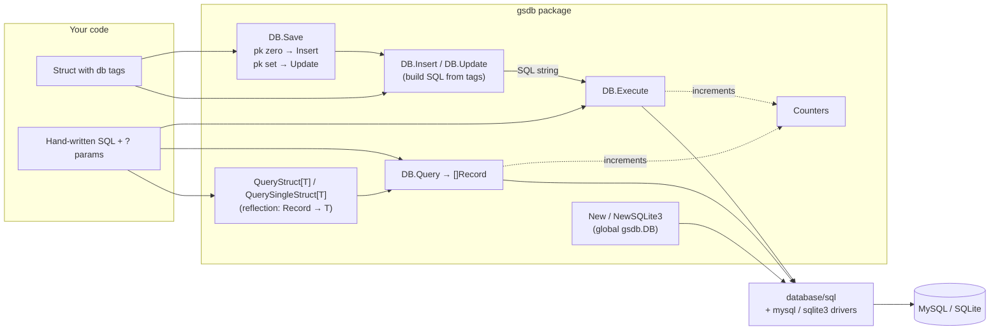

# How GSDB works

GSDB is a thin layer over `database/sql`. It has no query builder for `SELECT`s and no
schema management. It does three jobs:

1. **Holds a connection**: one global `*gsdb.Database` in `gsdb.DB`.
2. **Reads rows** into `Record`s (maps of `Field`s), and from there into structs.
3. **Writes structs** by generating `INSERT`/`UPDATE` SQL from `db` struct tags.

## Connection (`New.go`)

- `New(dsn, logger, ctx)` stores the DSN. The MySQL pool is opened lazily by
  `getConnection()` on the first `Execute`/`Query`: it calls `sql.Open("mysql", dsn)` and
  `Ping()`, retrying up to 3 times, then applies `MaxOpenConns`, `MaxIdleConns` and a
  5-minute idle timeout.
- `NewSQLite3(file, logger, ctx)` opens the SQLite handle straight away and marks the
  connection ready.
- A mutex guards connection setup so concurrent first calls don't open several pools.

## Reading (`Query.go`, `QueryStruct.go`, `Fields.go`)

`DB.Query` scans every row into `[]interface{}` and builds a `Record`
(`map[string]Field`) per row. `[]byte` values (how the MySQL driver returns most text and
dates) are converted to `string`; other values are stored as returned by the driver.

`QueryStruct[T]` calls `DB.Query`, then for every column:

1. Finds the struct field whose `column=` tag matches the column name.
2. Uses the field's Go type to pick a converter: `AsInt64`, `AsUInt64`, `AsBool`,
   `AsFloat`, `AsString`, `AsDate(readdefault)` or `AsByte`.
3. Sets the field via reflection.

Columns with no matching field are skipped (with a warning when `ColumnWarnings` is on).
`QuerySingleStruct[T]` returns the first result, or the zero `T` if there are none.

## Writing (`Insert.go`, `Update.go`, `Save.go`, `common.go`)

`decodeTag` turns `db:"column=id primarykey=yes table=people"` into a map. The SQL
builders walk the struct's exported fields:

- Fields with `omit=yes` or `primarykey=yes` are left out of the column list.
- Values are formatted by type: numbers and bools as-is, strings as hex literals
  (`X'...'`), times as `'YYYY-MM-DD HH:MM:SS'`, and zero times as `NULL` when
  `readdefault=null`.
- `Update` adds `WHERE <pk column>=<pk value>`.

`Save(v, pk)` checks whether `pk` is the zero value and calls `Insert` or `Update`, then
`Execute`.

## Counters (`counters.go`)

`StartCounter(name)` adds a named counter at 0. Every `Execute` and `Query` increments all
existing counters, and `GetCounter(name)` reads one. Access is mutex-protected.
